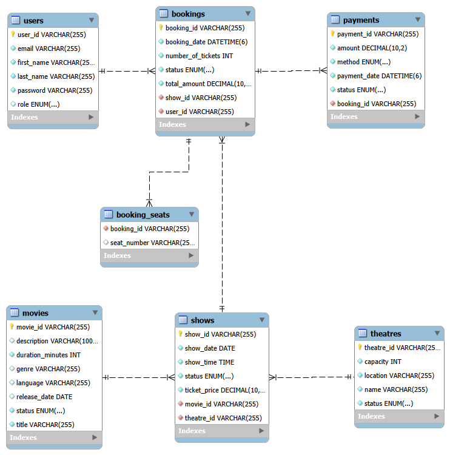

# Movie Ticket Booking System – Backend

Spring Boot REST API for browsing movies, theatres and shows, booking seats and paying for bookings. It uses JWT authentication with two roles: ADMIN and CUSTOMER.

## Technologies
- Java 25, Spring Boot 4.1.1, Maven
- Spring Data JPA (Hibernate), MySQL
- Spring Security with JWT (JJWT 0.12.6)
- ModelMapper, Lombok, Bean Validation

## Database setup
1. Install MySQL and make sure it is running on port 3306.
2. The database `movie_booking_db` is created automatically on first start
   (`createDatabaseIfNotExist=true`). To create it manually instead:
   `CREATE DATABASE movie_booking_db;`
3. Open `src/main/resources/application-dev.properties` and set your MySQL
   username and password in `spring.datasource.username` and `spring.datasource.password`.
4. Tables are created automatically (`spring.jpa.hibernate.ddl-auto=update`).

## How to run
1. Clone: `git clone https://github.com/ChanmiTharinsa/movie-ticket-booking-backend.git`
2. Run `mvn spring-boot:run` (or run it from NetBeans).
3. The API starts at `http://localhost:8081`.

## Admin login
An admin account is created on first start:
- Email: `admin@moviebooking.com`
- Password: `Admin@123`

New users who sign up always get the CUSTOMER role.

## Authentication
1. `POST /api/auth/signin` returns a `token`.
2. Send it with every other request: `Authorization: Bearer <token>`.

## Endpoints
| Method | Path | Access |
|---|---|---|
| POST | /api/auth/signup, /api/auth/signin | Public |
| GET | /api/movies, /api/theatres, /api/shows (+ /{id}) | Logged in |
| POST/PUT/DELETE | /api/movies, /api/theatres, /api/shows | ADMIN |
| * | /api/users | ADMIN |
| POST | /api/bookings | Logged in |
| GET | /api/bookings/my-bookings | Logged in |
| GET | /api/bookings | ADMIN |
| GET | /api/bookings/{id} | Owner or ADMIN |
| PUT | /api/bookings/{id}/cancel | Owner or ADMIN |
| POST | /api/payments | Owner or ADMIN |
| GET | /api/payments | ADMIN |
| GET | /api/payments/{id} | Owner or ADMIN |

Replace `<show id>` and `<booking id>` with the ids returned by the API when you create a show or a booking.

## Sample requests
Sign in:
```json
POST /api/auth/signin
{ "email": "admin@moviebooking.com", "password": "Admin@123" }
```
Create a booking:
```json
POST /api/bookings
{ "showId": "<show id>", "seatNumbers": ["A1", "A2"], "numberOfTickets": 2 }
```
Pay for a booking:
```json
POST /api/payments
{ "bookingId": "<booking id>", "method": "CARD" }
```
Payment is a mock gateway. Add `"simulateFailure": true` to test a failed payment.

## Business rules
- No new shows for ENDED movies, and shows only for ACTIVE theatres.
- No two shows in the same theatre at the same date and time.
- Cancelled or completed shows cannot be booked.
- At least one seat is required, and tickets must equal the number of seats.
- A seat cannot be booked twice for the same show (cancelled bookings free their seats).
- Total amount = ticket price × number of tickets, calculated on the server.
- Cancelled bookings cannot be paid. A COMPLETED payment confirms the booking, a FAILED one does not, and a completed payment cannot be processed again.

## ERD


## Future expansion

### 1. Real online payments
- **Feature:** Connect a real payment service (for example PayHere or Stripe) instead of the mock payment.
- **Why it is useful:** Customers could pay with a real card, and a booking would be confirmed only after the bank approves the payment.
- **Existing entities affected:** `Payment` (status would depend on the gateway response) and `Booking` (confirmed only after a successful payment).
- **New entities:** `PaymentTransaction`, storing the gateway reference, response and time.
- **Database change:** One `Payment` can have many `PaymentTransaction` records (one-to-many), so failed attempts and retries are all recorded.

### 2. Email / SMS booking confirmation
- **Feature:** After a booking is confirmed, send the customer a message with the movie, show time, theatre and seats.
- **Why it is useful:** Customers keep their booking details and are less likely to go to the wrong show.
- **Existing entities affected:** `User` (email or phone is used to send) and `Booking` (its confirmation triggers the message).
- **New entities:** `Notification` (type, status, sent time).
- **Database change:** `Notification` links to `User` and to `Booking` (many-to-one each), so we know what was sent and to whom.

### 3. Seat map and seat locking
- **Feature:** Show a seat map with booked and free seats, and hold a seat for a few minutes while the customer pays.
- **Why it is useful:** Two customers can no longer choose the same seat at the same time.
- **Existing entities affected:** `Theatre`, `Show` and `Booking` (seats are currently stored as a list of seat codes).
- **New entities:** `Screen`, `Seat` and `SeatLock`.
- **Database change:** A `Theatre` has many `Screen`s, a `Screen` has many `Seat`s, a `Show` belongs to a `Screen`, and `Booking` and `Seat` become many-to-many. `SeatLock` links a seat, a show and a user, with an expiry time.

## Repository submission process
1. Work on feature branches, then merge them into `main`.
2. Push `main` to GitHub: `git push origin main`.
3. Check that the README and ERD display on the GitHub page.
4. Submit the repository URL: https://github.com/ChanmiTharinsa/movie-ticket-booking-backend